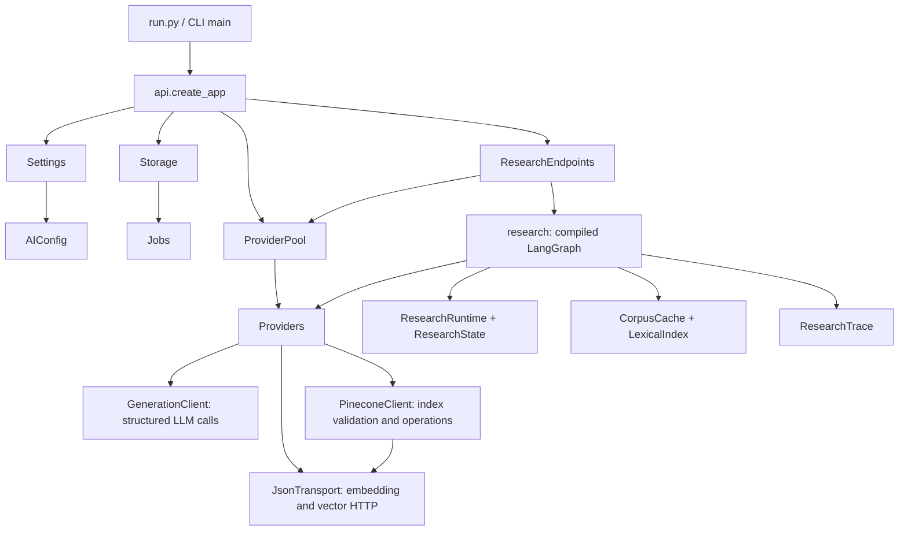

# Python backend: where classes are used

Start with the entry points below, then follow the arrows. Class and method
docstrings in `backend/src/finwhiz` describe their callers, inputs/outputs,
side effects and important failures. In the IDE, hover over a method or use
**Go to Definition**; use **Find All References** for the current call sites.
The caller lists in docstrings identify the main paths, not every test/helper.

## Entry points and object ownership

- [cli.py](../backend/src/finwhiz/cli.py): `main()` reads arguments and settings;
  `execute()` dispatches serve, ingestion, evaluation and maintenance commands.
- [api.py](../backend/src/finwhiz/api.py): `create_app()` assembles the HTTP app.
  Its lifespan owns the runtime lock, worker startup/recovery and shutdown.
- [routes.py](../backend/src/finwhiz/routes.py): registers explicit paths/methods
  and forwards to workspace, document, research or maintenance handlers.

Classes below are ordinary services unless identified as data contracts.
Most parsing, financial and graph logic is intentionally implemented as module
functions; there is no hidden controller class behind those functions.

## Service classes

| Class | Who creates/uses it? | Read these methods first |
|---|---|---|
| [Settings](../backend/src/finwhiz/config.py) | API/CLI startup; passed to server services. Holds credentials and limits. | `provider()` makes a nonsecret snapshot; `key()` accesses credentials; `configured()` checks presence only. |
| [AIConfig](../backend/src/finwhiz/config.py) | Built by `Settings.provider()`, stored in jobs, used by provider/cache matching. | `fingerprint` identifies compatible embeddings, not chat-model identity. |
| [AppError](../backend/src/finwhiz/config.py) | Raised by service validation/failure paths and converted to JSON by the API. | `__init__(message, status)` carries the public message and HTTP status. |
| [Storage](../backend/src/finwhiz/storage.py) | API/CLI startup; upload, ingestion, research and maintenance share one runtime. | `get/put` handle blobs; `json/put_json` handle artifacts; `path` hashes logical keys. |
| [Jobs](../backend/src/finwhiz/storage.py) | API/CLI startup; routes and worker use its SQLite registry. | `add → claim → update`; `retry/recover` resume work; `connection` controls transactions. |
| [ResearchEndpoints](../backend/src/finwhiz/research_routes.py) | One instance created by `create_app`; research routes call `__call__`. | `__call__` parses input, resolves scope, admits chat tasks and calls `research()` in a thread. |
| [ProviderPool](../backend/src/finwhiz/providers.py) | One per API app; `ResearchEndpoints` requests a client. | `get` reuses clients by config; `close` runs on shutdown. |
| [Providers](../backend/src/finwhiz/providers.py) | Pool in the API, direct construction in CLI/worker paths. | `embed`, `structured`, `pinecone`, `upsert` form the facade used by workflows. |
| [GenerationClient](../backend/src/finwhiz/generation.py) | Created by `Providers`; reached through `Providers.structured`. | `structured` builds the LangChain call, applies task timeouts/retries and validates model output. |
| [JsonTransport](../backend/src/finwhiz/transport.py) | Created by `Providers`; reached through `Providers.request`. | `request` handles embedding/vector JSON HTTP, retry classification and deadlines. |
| [PineconeClient](../backend/src/finwhiz/vector_store.py) | Created by `Providers`; delegates HTTP back through `Providers.request`. | `pinecone_host` validates/caches the endpoint; `pinecone` executes operations; `upsert` batches writes. |
| [CorpusCache](../backend/src/finwhiz/lexical.py) | Module-level `CORPORA`; retrieval calls `load`. | `load` returns cached chunks and term counts, invalidated by file signature. |
| [LexicalIndex](../backend/src/finwhiz/lexical.py) | Cache prepares counts; retrieval creates a scoped scorer. | `score` returns ranked BM25 records using only the selected corpus. |
| [ResearchTrace](../backend/src/finwhiz/telemetry.py) | Endpoint or direct `research()` caller creates one per request. | `remaining` enforces time/cancellation; `record` collects timings; `metrics` returns diagnostics. |
| [BodyLimit](../backend/src/finwhiz/http_helpers.py) | Registered in `create_app`; instantiated/invoked by FastAPI/Starlette. | `__call__` counts HTTP body bytes before multipart parsing. |

`GenerationClient` and `JsonTransport` share an HTTP client but have different
responsibilities: generation uses LangChain, while embedding and Pinecone
requests use the JSON adapter. Closing `Providers` closes that shared client.

## Data contracts, not active services

These classes mainly describe fields. Their constructors/serialization methods
come from Pydantic, dataclasses or typing; application behavior lives elsewhere.

| Contract | Producer → consumer |
|---|---|
| [ResearchRequest](../backend/src/finwhiz/research_requests.py) | `parse_request()` → `ResearchEndpoints`; its validators check question text and dates. |
| [ResearchRuntime / ResearchState](../backend/src/finwhiz/research.py) | `research()` → graph nodes; request dependencies/state are isolated even though the compiled graph is shared. |
| [IngestionState](../backend/src/finwhiz/ingestion.py) | `ingest()` → ingestion nodes; contains references/version, not large document/vector payloads. |
| [FinancialFact](../backend/src/finwhiz/financial_facts.py) | `table_facts()` → calculation handlers, fact validation and prompt serialization. |
| [ChunkRecord / Evidence / RetrievalResult](../backend/src/finwhiz/domain_types.py) | Ingestion/retrieval → research and evaluation. `TypedDict` annotates dictionaries; it does not validate them at runtime. |
| [ResearchProvider](../backend/src/finwhiz/domain_types.py) | Protocol implemented by `Providers` and offline fakes; specifies operations required by research/retrieval. |
| [StrictModel](../backend/src/finwhiz/schemas.py) | Base policy for the LLM output models below: strict fields and finite numbers. |
| [Answer / Chart / Point / Calculation](../backend/src/finwhiz/schemas.py) | Model generation → answer validation → browser response; arithmetic results are computed by Python. |
| [Ranking](../backend/src/finwhiz/schemas.py) | Reranking model → `retrieval.complete_ranking()`. |
| [AgentDecision](../backend/src/finwhiz/schemas.py) | Evidence-assessment model → `agentic.assess()` argument checks → graph routing. |
| [Repair / Sentence](../backend/src/finwhiz/schemas.py) | Repair model → citation rendering and another mandatory validation pass. |
| [Review / Claim](../backend/src/finwhiz/schemas.py) | Evaluation model → evaluation reports; separate from interactive answer validation. |

Passing a Pydantic schema to `Providers.structured()` tells `GenerationClient`
which response shape to request. Pydantic checks the shape; it does not establish
that a financial claim is supported. Class docstrings can also appear as schema
descriptions in the model-facing JSON schema.

## Trace one chat request

1. `api.security` authenticates and chooses an `AIConfig` using `Settings.provider`.
2. `ResearchEndpoints.__call__` parses `ResearchRequest`, reads `Jobs.all`, and
   calls [resolve_scope](../backend/src/finwhiz/scope.py) with the catalog.
   `/api/scope` returns here; `/api/chat` starts research with a pooled provider.
3. [research()](../backend/src/finwhiz/research.py) supplies `ResearchRuntime` to
   `RESEARCH_GRAPH`. Its nested node functions are framework callbacks, not
   methods on a controller. A pre-resolved scope is reused.
4. [retrieve()](../backend/src/finwhiz/retrieval.py) loads chunks using `CORPORA`.
   A complete local calculation can return immediately. Otherwise, BM25 uses
   `LexicalIndex`; vectors use `Providers.embed/pinecone`; optional reranking
   uses `Providers.structured(..., Ranking)`.
5. [agentic.py](../backend/src/finwhiz/agentic.py) asks for `AgentDecision` when
   enabled and useful. The graph can run a scoped follow-up search or read a
   trusted table, within fixed action/time limits.
6. [calculation_handlers.py](../backend/src/finwhiz/calculation_handlers.py)
   tries supported deterministic arithmetic. Otherwise generation requests an
   `Answer`; invalid output may request one `Repair`.
7. [answer_validation.py](../backend/src/finwhiz/answer_validation.py) and
   [fact_validation.py](../backend/src/finwhiz/fact_validation.py) check numeric
   identity, coverage and citations. Only cited evidence is returned with
   `ResearchTrace.metrics()` diagnostics.

## Trace one upload

`document_routes.documents → receive_files → Storage.put → Jobs.add`

Worker supervision claims queued jobs. `worker_main → ingest()` runs the
parse/chunk/index/verify/publish graph, persists artifacts through `Storage`,
creates embeddings through `Providers`, and writes vectors through
`PineconeClient.upsert`. It updates `Jobs` along the way. A job becomes available
to research after verification/publishing marks it ready.
